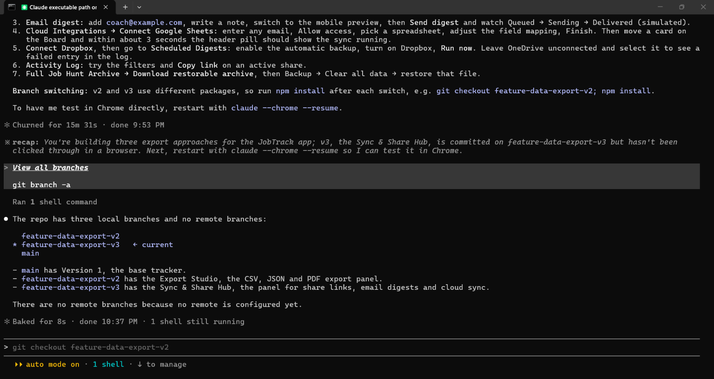
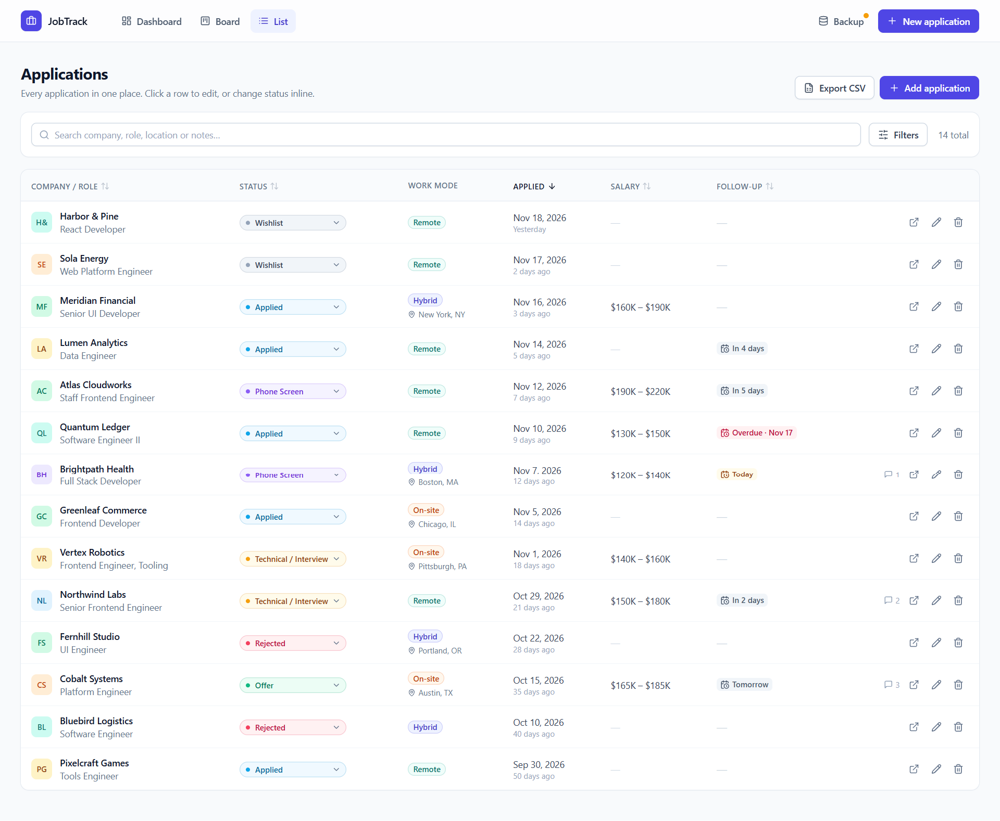
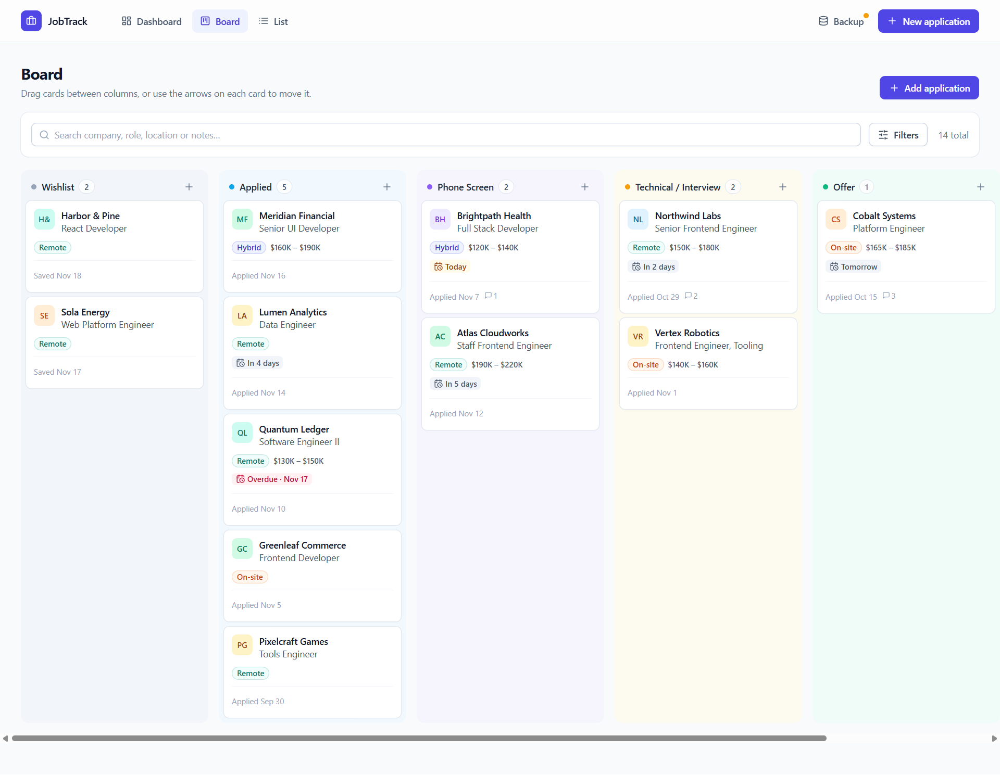
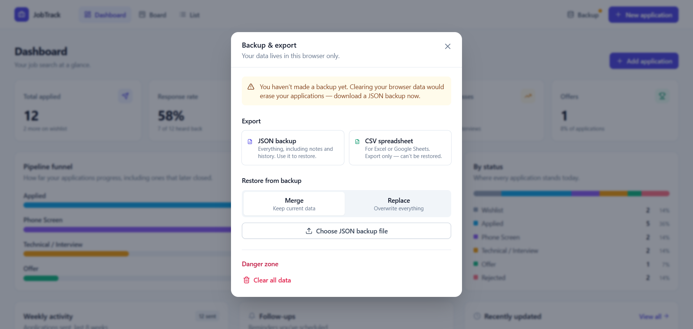
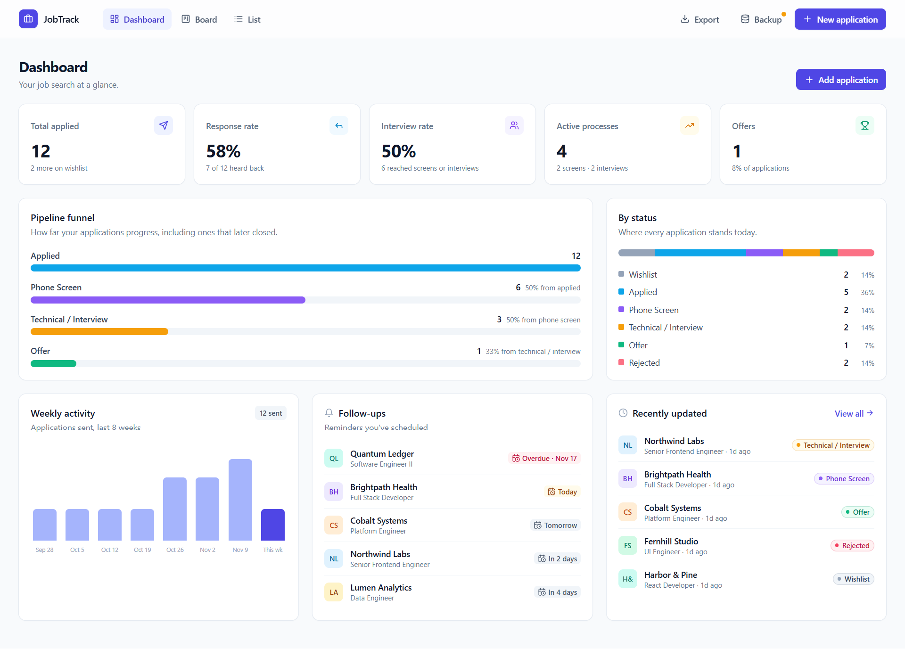
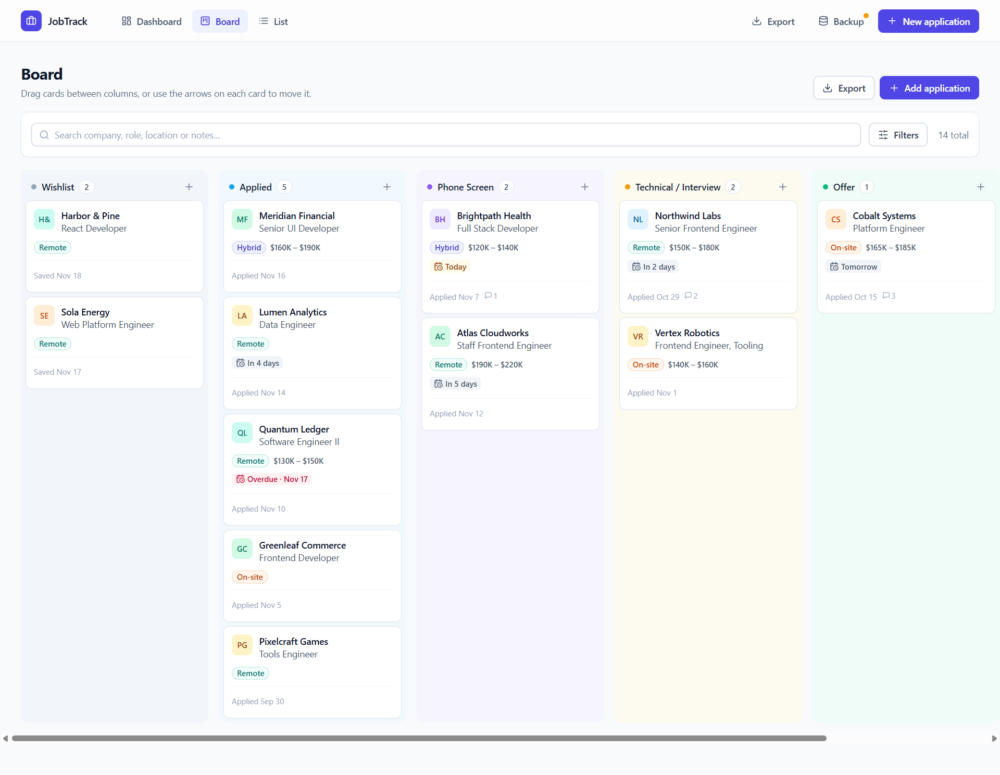
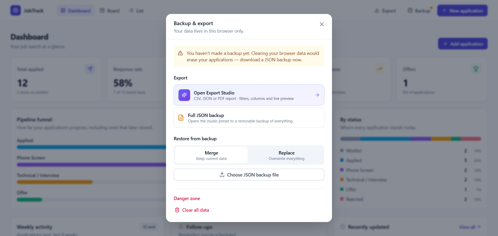
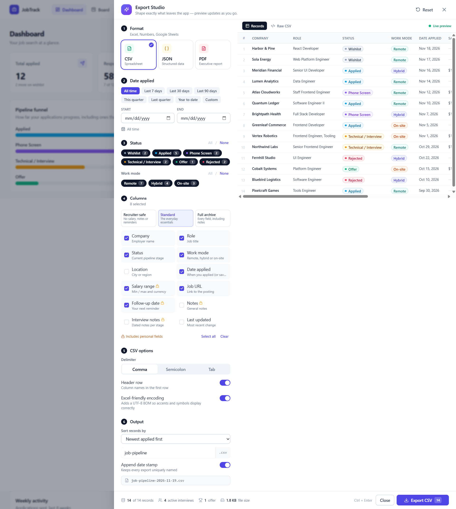
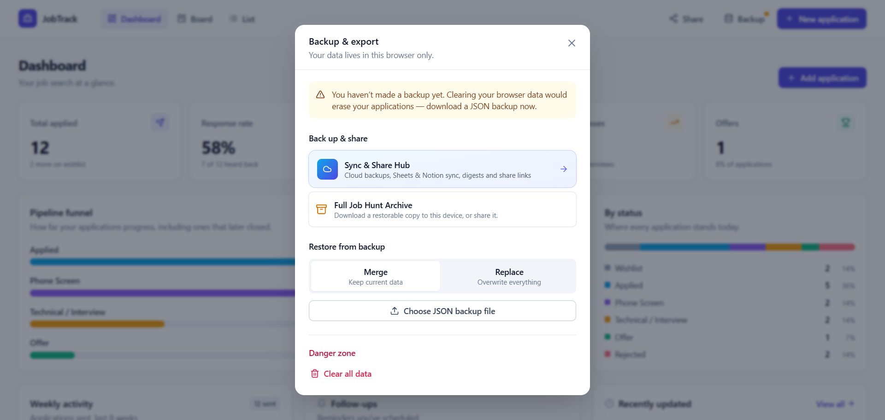
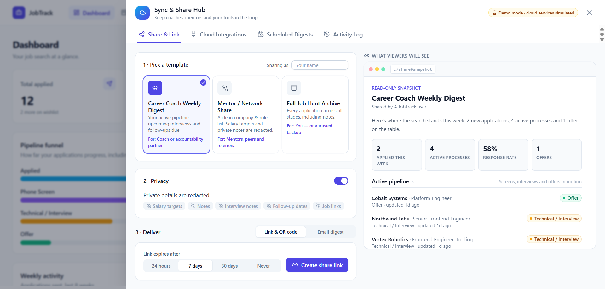

<div align="center">

  <h1>💼 Job Tracker AI</h1>

  <p>
    A Next.js job application tracker built across three Git branches to explore different approaches to data export and cloud sharing.
  </p>

</div>

<hr>

<h2>📑 Table of Contents</h2>

<ul>
  <li><a href="#objective">Objective</a></li>
  <li><a href="#project-details">Project Details</a></li>
  <li><a href="#prompt purpose">Prompt Purpose</a></li>
  <li><a href="#prompts">Prompts</a></li>
  <li><a href="#images">Images</a></li>
</ul>

<hr>

<h2 id="objective">🎯 Objective</h2>

<p>
This project demonstrates iterative software architecture and Git feature-branch workflows using Next.js 14, TypeScript, and Tailwind CSS. It begins with basic CSV and JSON backups on main, then expands into an advanced local export studio with live previews and PDF reports on feature-data-export-v2. Finally, feature-data-export-v3 introduces a collaborative cloud sync and sharing hub. The entire multi-branch application was conceptualized and built using Gemini and Claude Code.
</p>

<hr>

<h2 id="project-details">🛠️ Project Details</h2>

<p>
  <strong>Tools:</strong> Gemini, Claude Code
</p>

<p>
  <strong>Workflow:</strong> Gemini → Claude Code
</p>

<p>
  <strong>Prompts:</strong> 3
</p>

<p>
  <strong>Models:</strong> Gemini 4 Hydrogen (2026), Claude Opus 5.5 (2026)
</p>

<p><strong>Format:</strong> Browser App</p>

<p><strong>Operating System:</strong> Windows</p>

<hr>

<h2 id="prompt purpose">💡 Prompt Purpose</h2>

<ul>
  <li>main (Version 1): Simple CSV Export</li>
  <li>feature-data-export-v2 (Version 2): Advanced Export with Options</li>
  <li>feature-data-export-v3 (Version 3): Cloud Integration</li>
</ul>

<hr>

<h2 id="prompts">⌨️ Prompts</h2>

<h3>Terminal</h3>

<details>
  <summary><strong>View Terminal Prompt</strong></summary>

```text
mkdir job-tracker-ai
cd job-tracker-ai

claude
```

</details>

<h3>main (Version 1)</h3>

<details>
  <summary><strong>View Version 1 Prompt</strong></summary>

```text
I want you to create a modern, professional NextJS job application tracking application. Here's my vision:

APPLICATION OVERVIEW:
Build a complete job search and application tracking web app that helps users organize their job hunt, track interview stages, and analyze their application pipeline. The app should feel modern, intuitive, and professional.

CORE FEATURES:
- Add job applications with company name, role title, date applied, status, work mode, salary range (optional), job posting URL, and notes
- View applications in both a clean, filterable table list view and an interactive Kanban board view grouped by status
- Filter applications by status, work mode, date range, and search by company or role
- Dashboard with pipeline summaries and basic analytics (total applied, active interviews, response rate, offers)
- Status stages: Wishlist, Applied, Phone Screen, Technical/Interview, Offer, Rejected
- Work modes: Remote, Hybrid, On-site
- Data persistence using localStorage for this demo, plus a JSON backup/restore option so data isn't lost if browser cache is cleared

TECHNICAL REQUIREMENTS:
- NextJS 14 with App Router
- TypeScript for type safety
- Tailwind CSS for styling with a modern, clean design
- Responsive design that works on desktop and mobile
- Use React hooks for state management
- Form validation for required fields (company, role, status, date) and valid URLs
- Date picker for application dates and follow-up reminders
- Clean badge color-coding for application statuses

DESIGN REQUIREMENTS:
- Clean, modern interface with a professional color scheme
- Intuitive navigation between Dashboard, Kanban Board, and List views
- Visual feedback for user actions (toast notifications on save, status change, or delete)
- Loading states and error handling
- Mobile-responsive design

SPECIFIC FUNCTIONALITY:
- Application modal/form with validation and quick-edit support
- Application list and Kanban board with search, filter, and one-click status updates
- Summary cards showing total applications, interview conversion rate, active processes, and offers
- Basic charts or visual funnel showing application breakdown by status
- Export functionality (CSV for spreadsheets and JSON for full backup/restore)
- Delete and edit existing applications, including adding interview notes

Please create this as a complete, production-ready application. Set up the project structure, implement all features, and make sure everything works together seamlessly. Focus on creating something that looks professional and that I could actually use to manage a real job search.

When you're done, provide instructions on how to run the application and test all features.
```

</details>

<h3>feature-data-export-v2 (Version 2)</h3>

<details>
  <summary><strong>View Version 2 Prompt</strong></summary>

```text
Excellent work on Version 1! Now I want you to upgrade our job application export experience by building a completely redesigned, power-user export system on a new Git branch.

VERSION CONTROL:
- Check the current git status and ensure Version 1 is cleanly committed on main/master
- Create and checkout a new branch called "feature-data-export-v2" (git checkout -b feature-data-export-v2)
- Keep the existing JSON backup/restore import functionality intact so we never lose data recovery, while replacing the basic export trigger with this completely new v2 export experience

VERSION 2 REQUIREMENTS:
Implement an ADVANCED Job Pipeline Export Studio with these features:
- Slide-over drawer or multi-section modal dialog with rich configuration controls
- Multiple export formats:
  1. CSV (clean spreadsheet format with customizable columns)
  2. JSON (structured data with metadata timestamp and summary stats)
  3. PDF (formatted executive job-search report with pipeline summary metrics, status breakdown, and clean application table)
- Date range filtering for exports (applied start date, end date, plus quick presets like "Last 30 Days", "This Quarter", "All Time")
- Multi-select status filtering (Wishlist, Applied, Phone Screen, Technical/Interview, Offer, Rejected) and work mode filtering (Remote, Hybrid, On-site)
- Column/field selector checkboxes (toggle Company, Role, Status, Work Mode, Date Applied, Salary Range, Job URL, Follow-up Date, Interview Notes) so users can create a clean recruiter-safe summary or a full personal archive
- Live preview table inside the modal showing the exact filtered records and selected columns before exporting
- Custom filename input field with automatic date stamp preview and extension handling
- Live export summary bar showing total matching records, active interview count, and estimated file size
- Realistic loading/generating states and toast confirmation when the file downloads

IMPLEMENTATION APPROACH:
This version should feel like a high-craft business intelligence export feature (think Linear, Notion, or Airtable). Give the user granular control and instant visual feedback as they toggle filters and columns.

Make this implementation architecturally clean and polished:
- Separate export formatting/generation logic into dedicated utility modules (e.g., src/lib/export/)
- Clean, reusable UI components for filter pills, column toggles, and live preview table
- Zero-dependency or lightweight client-side PDF generation (such as jspdf + jspdf-autotable or a clean print-to-PDF layout) that works reliably in Next.js App Router
- Full TypeScript types and responsive layout on desktop and mobile

PROCESS:
1. Ensure Version 1 is committed on the base branch
2. Create and checkout: git checkout -b feature-data-export-v2
3. Install any lightweight PDF dependency if needed and implement the advanced export system
4. Verify TypeScript compilation and test all export formats, filters, and previews
5. Commit your changes to feature-data-export-v2 and summarize how to test the new features

Show me what's possible with a more sophisticated approach. Be creative!
```

</details>

<h3>feature-data-export-v3 (Version 3)</h3>

<details>
  <summary><strong>View Version 3 Prompt</strong></summary>

```text
Great work on Version 2! Now let's build a third, completely different approach to exporting and sharing our job search data—focused on cloud connectivity, workspace integrations, and sharing.

VERSION CONTROL:
- Check the current git status and ensure Version 2 is cleanly committed on its branch
- Switch back to the original base branch (main/master)
- Create and checkout a new branch called "feature-data-export-v3" (git checkout -b feature-data-export-v3)
- Keep the existing JSON restore/import functionality intact so data recovery still works, while replacing the export UI with a brand-new Cloud Sync & Share Hub

VERSION 3 REQUIREMENTS:
Implement a CLOUD-INTEGRATED Job Sync & Share Hub with these features:
- Email digest & report sender (interactive UI flow where users enter a recipient email—like a career coach, mentor, or accountability partner—pick a template, preview the formatted email summary, and simulate sending with delivery status)
- Google Sheets & Notion two-way sync mockup (interactive connection flow with simulated OAuth connect toggle, target spreadsheet/database picker, column mapping preview, and "Sync Now" animation)
- Automatic backup & digest scheduling (UI to configure recurring cloud backups or weekly Sunday pipeline digests with frequency, day/time, and destination toggles, persisted in localStorage)
- Export & sync activity log (timeline history showing previous exports, cloud syncs, and shared links with timestamps, destination badges, record counts, and status indicators)
- Live sharing capabilities — generate a read-only shareable snapshot link (with copy-to-clipboard button, expiration toggle, and privacy redaction toggle) plus an instant scannable QR code (rendered via clean client-side SVG) for sharing with mentors or peers
- Purpose-built Job Search Templates:
  1. "Career Coach Weekly Digest" (active pipeline, upcoming interviews, and follow-ups due)
  2. "Mentor / Network Share" (clean company/role list with salary targets and private notes automatically redacted)
  3. "Full Job Hunt Archive" (complete backup snapshot across all stages and notes)
- Cloud destination cards with realistic connection states and sync status indicators (Google Drive, Notion, Dropbox, OneDrive)

IMPLEMENTATION APPROACH:
Think like Notion, Airtable, or Linear—focus on ecosystem connectivity, background sync states, privacy controls, and effortless sharing rather than raw file downloads.

Make this implementation completely different from both Version 1 and Version 2:
- Tabbed "Cloud Sync & Share Hub" drawer or full modal experience (tabs for: Share & Link, Cloud Integrations, Scheduled Digests, and Activity Log)
- Interactive connection toggles, simulated background sync progress bars, and real-time sync status badges ("Synced just now", "Scheduled: Sundays 6:00 PM")
- Clean modular architecture (e.g., src/lib/cloud-sync/ and src/components/cloud-hub/)
- Full TypeScript types, zero external API keys required (all cloud flows simulated smoothly in-browser with persisted settings/history in localStorage), and responsive mobile/desktop design

PROCESS:
1. Ensure previous work is committed, switch back to the base branch (main/master)
2. Create and checkout: git checkout -b feature-data-export-v3
3. Implement the Cloud Sync & Share Hub
4. Verify TypeScript compilation and test every tab, template, QR code, and simulated sync flow
5. Commit your changes to feature-data-export-v3 and provide instructions to test all features

Think big picture — surprise me with thoughtful touches that make a job search feel connected, organized, and collaborative!
```

</details>

<h3>Browser</h3>

<details>
  <summary><strong>View Browser Prompt</strong></summary>

```text
http://localhost:3000/
```

</details>

<h3>Switch Between Branches</h3>

<details>
  <summary><strong>View Switch Prompt</strong></summary>

```text
# View all branches
git branch -a

# Switch to Version 1
git checkout main
npm run dev

# Switch to Version 2
git checkout feature-data-export-v2
npm run dev

# Switch to Version 3
git checkout feature-data-export-v3
npm run dev
```

</details>

<hr>

<h2 id="images">🖼️ Images</h2>

<h3>View All Branches</h3>

<table>
  <tr>
    <td>
      <a href="https://github.com/redefiningvicky/Job-Tracker-AI/blob/main/Images/view_all_branches.png">
        
      </a>
    </td>
  </tr>
</table>

<h3>Version 1 Dashboard</h3>

<table>
  <tr>
    <td>
      <a href="https://github.com/redefiningvicky/Job-Tracker-AI/blob/main/Images/v1_dashboard.png">
        
      </a>
    </td>
  </tr>
</table>

<h3>Version 1 Board</h3>

<table>
  <tr>
    <td>
      <a href="https://github.com/redefiningvicky/Job-Tracker-AI/blob/main/Images/v1_board.png">
        
      </a>
    </td>
  </tr>
</table>

<h3>Version 1 List</h3>

<table>
  <tr>
    <td>
      <a href="https://github.com/redefiningvicky/Job-Tracker-AI/blob/main/Images/v1_list.png">
        
      </a>
    </td>
  </tr>
</table>

<h3>Version 1 Backup</h3>

<table>
  <tr>
    <td>
      <a href="https://github.com/redefiningvicky/Job-Tracker-AI/blob/main/Images/v1_backup.png">
        
      </a>
    </td>
  </tr>
</table>

<h3>Version 2 and 3 Dashboard</h3>

<table>
  <tr>
    <td>
      <a href="https://github.com/redefiningvicky/Job-Tracker-AI/blob/main/Images/v2_v3_dashboard.png">
        
      </a>
    </td>
  </tr>
</table>

<h3>Version 2 and 3 Board</h3>

<table>
  <tr>
    <td>
      <a href="https://github.com/redefiningvicky/Job-Tracker-AI/blob/main/Images/v2_v3_board.png">
        
      </a>
    </td>
  </tr>
</table>

<h3>Version 2 and 3 List</h3>

<table>
  <tr>
    <td>
      <a href="https://github.com/redefiningvicky/Job-Tracker-AI/blob/main/Images/v2_v3_list.png">
        
      </a>
    </td>
  </tr>
</table>

<h3>Version 2 Backup</h3>

<table>
  <tr>
    <td>
      <a href="https://github.com/redefiningvicky/Job-Tracker-AI/blob/main/Images/v2_backup.png">
        
      </a>
    </td>
  </tr>
</table>

<h3>Version 2 Export</h3>

<table>
  <tr>
    <td>
      <a href="https://github.com/redefiningvicky/Job-Tracker-AI/blob/main/Images/v2_export.png">
        
      </a>
    </td>
  </tr>
</table>

<h3>Version 3 Backup</h3>

<table>
  <tr>
    <td>
      <a href="https://github.com/redefiningvicky/Job-Tracker-AI/blob/main/Images/v3_backup.png">
        
      </a>
    </td>
  </tr>
</table>

<h3>Version 3 Export</h3>

<table>
  <tr>
    <td>
      <a href="https://github.com/redefiningvicky/Job-Tracker-AI/blob/main/Images/v3_export.png">
        
      </a>
    </td>
  </tr>
</table>

<hr>

<div align="center">

  <p>
    <a href="https://github.com/redefiningvicky/redefiningvicky">
      Back to Portfolio
    </a>
  </p>

</div>
